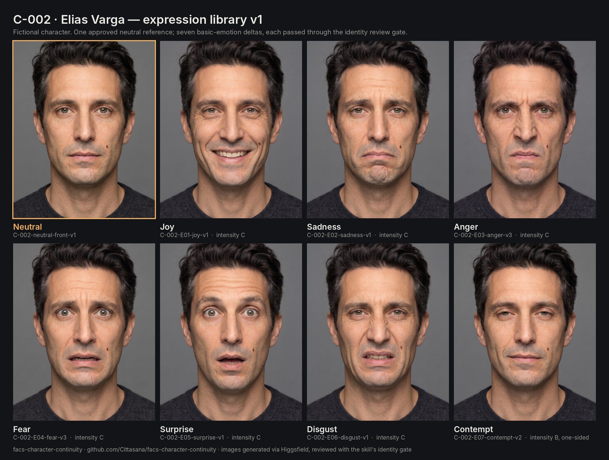

# Example character card: C-002 "Elias Varga" — reference image and the seven basic emotions

A worked example with real generated images: one approved neutral reference portrait and seven basic-emotion expressions (joy, sadness, anger, fear, surprise, disgust, contempt), each directed as a delta from the reference and passed through the skill's identity review gate.



> Elias Varga is an invented character. The images are AI-generated and do not depict a real person. Emotion labels are dramatic readings of visible facial movement, not claims about anyone's inner state. All observations below are visual descriptions made by a reviewer; nothing was measured.

---

## 1. Character ID and baseline

```yaml
character_id: C-002
display_name: Elias Varga
baseline_set: C-002-neutral-v1
baseline_views:
  - id: C-002-neutral-front-v1          # images/C-002-neutral-front-v1.jpg
    role: neutral_front
baseline_capture: "Head and shoulders, front view, eye level, neutral relaxed face, mouth closed, soft even frontal studio light, medium-grey background, charcoal crew-neck sweater"
baseline_selection: "Two neutral candidates generated; candidate A adopted, candidate B not used (fuller, more sculpted lips and a smoother, retouched look than the brief asked for)"
assessment_basis: visual_assist_review
```

**Limitation:** this pack has a front view only. Expressions in this library are reliable for front-facing shots. Before using C-002 in three-quarter or profile shots, generate and approve the missing neutral views (three-quarter left, three-quarter right, profile), as the skill requires.

## 2. Locked identity (as observed in the approved reference)

The brief asked for a few details the generator did not render (a slight bend in the nose, a visibly higher left brow, the mole on the other cheek). The locked identity records what the approved image actually shows, not what the brief asked for.

```yaml
identity_lock:
  apparent_age: "Early 40s"
  skin: "Light-medium with a warm olive undertone; visible pores, fine freckles on cheeks and forehead, faint horizontal forehead lines"
  face_shape: "Long face, defined jaw, prominent cheekbones, broad chin"
  eyes_and_lids: "Hazel-green irises, slightly deep-set, mildly hooded upper lids, fine lines below the eyes"
  brows: "Dark, medium thickness, fairly straight, slightly lower toward the inner ends; no strong height difference visible"
  nose: "Long, narrow, straight bridge; symmetric at rest"
  hair_and_hairline: "Near-black dark brown, short sides, tousled top, grey strands at the temples"
  facial_hair: "Short even stubble on upper lip, chin and jaw"
  ears: "Visible, standing slightly away from the head"
  fixed_marks:
    - "Small dark mole on his left cheek (image right), between the nose-to-mouth fold and the jaw"
    - "Thin pale vertical scar on the chin, on his left of centre (image right), from below the lower lip toward the chin"
    - "Short faint vertical mark below his right mouth corner (image left)"
  established_asymmetries: "No strong resting asymmetry visible; the mole and the scar are the main one-sided landmarks"
  mouth_lower_face_neutral:
    mouth_width: "Mouth corners sit roughly below the pupils, slightly inside them"
    upper_lower_lip_visibility: "Both lips visible; upper lip clearly thinner than the lower lip"
    lip_contour_and_cupids_bow: "Soft, low cupid's bow; even lower-lip contour"
    philtrum: "Medium length, shallow"
    mouth_corners_and_asymmetry: "Corners level and neutral"
    lower_lip_to_chin_spacing: "Moderate"
    chin_and_jaw_transition: "Broad chin with a soft transition into a defined jaw"
```

## 3. Generation setup

- **Tool:** Higgsfield image generation. Requested model ID `nano_banana_pro`; the job records report `nano_banana_2`.
- **Reference:** every expression used the approved neutral image as its reference input (anger v3 also used anger v2 as its starting image; see the review log).
- **Format:** 4:5, 2k, one image per request.
- **Credits:** 14 generations at 2 credits each (2 neutral candidates, 7 first expressions, 5 regenerations).

**Prompt frame used for every expression** (only the bracketed part changes):

```text
Edit the reference photo. Same man, same identity: preserve his facial geometry, eye and
eyelid shape, hairline, grey at the temples, skin texture with pores and freckles, stubble,
the small dark mole on his cheek on the right side of the image and the thin pale vertical
scar on his chin on the right side of the image, neutral mouth width, lip contour, philtrum,
lower-lip-to-chin relation and chin-to-jaw transition. Do not redesign the face or alter
these features beyond the specified expression. Keep the same front view, head position,
framing, crop, soft even studio light, medium-grey background, hair and charcoal sweater
exactly as in the reference.
Requested expression delta: [visible action plan per region].
Target intensity: [per region, A-E]. [Symmetry]. Looking straight into the camera, head straight.
Photorealistic and unretouched. Avoid beauty retouching, a theatrical grimace, accidental
symmetry, changed age, changed identity, or a different intensity.
```

## 4. Expression library

Intensity uses the skill's A–E scale (A barely detectable, E near maximum). Every expression targets C or lower so the library stays usable for screen acting.

| ID | Dramatic read | Visible action plan (delta from neutral) | Target intensity | Symmetry | Adopted image |
|---|---|---|---|---|---|
| E01 | Joy | Cheeks lift, nose-to-mouth folds deepen; lower lids push up with crow's-feet creases; corners pull up and back, lips part to show upper teeth; brows relaxed | cheeks C, eyes C, mouth C | natural | [E01-joy-v1](images/C-002-E01-joy-v1.jpg) |
| E02 | Sadness | Inner brow ends rise and draw together, short central forehead wrinkles; upper lids droop slightly; corners pull down, chin pushes up so the lower lip bulges | brows C, eyes B, mouth C | natural | [E02-sadness-v1](images/C-002-E02-sadness-v1.jpg) |
| E03 | Anger | Brows pull down and together with vertical furrows; hard stare; nostrils flare; lips pressed so the lip line thins; chin and jaw tense | brows C, eyes C, nose B, mouth C | natural | [E03-anger-v3](images/C-002-E03-anger-v3.jpg) |
| E04 | Fear | Brows raised and pulled together (lifted but flat), central forehead wrinkles; upper lids wide with white above the irises; lips stretched sideways, mouth slightly open | brows C, eyes C, mouth C | natural | [E04-fear-v3](images/C-002-E04-fear-v3.jpg) |
| E05 | Surprise | Brows raised high and curved with long forehead lines; upper lids wide; jaw drops into a relaxed open oval, no lip tension | brows C, eyes C, mouth C | natural | [E05-surprise-v1](images/C-002-E05-surprise-v1.jpg) |
| E06 | Disgust | Nose wrinkles across the bridge; cheeks rise; upper lip lifts to show a little of the upper teeth, folds deepen; brows lower slightly; lower lids push up | nose/cheeks C, mouth C, brows B, eyes B | natural | [E06-disgust-v1](images/C-002-E06-disgust-v1.jpg) |
| E07 | Contempt | Only the mouth corner on the side without the mole (image left) tightens and pulls slightly up and back with a small dimple; other corner neutral; lids lower slightly | mouth B, eyes A | one-sided, image left | [E07-contempt-v2](images/C-002-E07-contempt-v2.jpg) |

## 5. Review log

Every candidate was compared with the neutral front reference at the same pose, crop, and light. "Marks" means the mole and chin scar were both visible in their recorded positions. Mesh and blendshape checks are `not_assessable` throughout, because no face tracker was used.

| Candidate | Identity | Lower face | Expression | Intensity | Pose/camera | Decision | Reason |
|---|---|---|---|---|---|---|---|
| Neutral A | — | — | — | — | — | **adopt** as `C-002-neutral-front-v1` | Closest to the brief on lip proportions; natural, unretouched skin |
| Neutral B | — | — | — | — | — | not used | Fuller, sculpted lips and a smoother, retouched look |
| E01 joy v1 | pass, marks | pass | pass | pass (C/C/C) | pass | **adopt** | Wider face and raised mole explained by the cheek lift |
| E02 sadness v1 | pass, marks | pass | pass | pass (C/B/C) | pass | **adopt** | Chin bunching explained by the requested chin raise |
| E03 anger v1 | pass, marks | pass | pass | **fail** | pass | regenerate | Lips only lightly pressed (mouth A–B), no nostril flare; see [rejected/E03-anger-v1](images/rejected/C-002-E03-anger-v1.jpg) |
| E03 anger v2 | pass, marks | pass | pass | **fail** | pass | regenerate | Brows, eyes, mouth at C, but nostrils barely changed (nose A, target B); see [rejected/E03-anger-v2](images/rejected/C-002-E03-anger-v2.jpg) |
| E03 anger v3 | pass, marks | pass | pass | pass (C/C/B/C) | pass | **adopt** | Refinement edit of v2 with the neutral as identity reference; skin reads slightly warmer and lines deeper, consistent with the tension |
| E04 fear v1 | pass, marks | pass | pass | **fail** | pass | regenerate | Mouth opened but not stretched sideways (mouth B); see [rejected/E04-fear-v1](images/rejected/C-002-E04-fear-v1.jpg) |
| E04 fear v2 | pass, marks | pass | pass | **fail** | pass | regenerate | Lips now stretched, but upper lids not wide enough (eyes B); see [rejected/E04-fear-v2](images/rejected/C-002-E04-fear-v2.jpg) |
| E04 fear v3 | pass, marks | pass | pass | pass (C/C/C) | pass, crop limited | **adopt** | Crop about 7% tighter than the reference; recorded as a limitation |
| E05 surprise v1 | pass, marks | pass | pass | pass (C/C/C) | pass | **adopt** | Open mouth stays relaxed, as requested |
| E06 disgust v1 | pass, marks | pass | pass | pass | pass | **adopt** | Extra creases explained by the nose wrinkle and cheek raise |
| E07 contempt v1 | pass, marks | pass | **fail** | pass (B/A) | pass | regenerate | Mouth corner pulled on the wrong side (the mole side); see [rejected/E07-contempt-v1](images/rejected/C-002-E07-contempt-v1.jpg) |
| E07 contempt v2 | pass, marks | pass | pass | pass (B/A–B) | pass | **adopt** | Correct side; prompt anchored the side to the mole instead of saying "his right" |

**Allowed use for every adopted image:** C-002, front view, studio light, charcoal-sweater costume, at the recorded intensity. None of them is an apex reference for stronger versions of the same emotion, and none replaces the neutral reference.

### Lessons from this run

- **Name sides by a visible landmark.** "His right side" was rendered on the wrong side once. "The side without the mole" worked first time.
- **Each region needs its own target.** Two of three regenerations passed the overall emotion but missed one region (nostrils, upper lids). Checking region by region is what caught them.
- **Document the reference, not the brief.** Three requested details never appeared in the neutral image, so the locked identity describes the approved image instead.

## 6. One full candidate record (schema format)

```yaml
character_id: C-002
baseline_set: C-002-neutral-v1
candidate_id: C-002-E07-contempt-v1
source_references: [C-002-neutral-front-v1]
requested_expression:
  brow_forehead: {action: "No requested change", target_intensity: "not_applicable"}
  eyelids_eyes: {action: "Upper lids lower very slightly into a cool, steady look at camera", target_intensity: "A"}
  cheeks_nose: {action: "No requested change", target_intensity: "not_applicable"}
  mouth_lips_jaw: {action: "Only his right mouth corner (image left) tightens and pulls slightly up and back with a small dimple; lips closed", target_intensity: "B"}
  symmetry: "right-biased (image left)"
observed_expression:
  brow_forehead: "Unchanged"
  eyelids_eyes: "Slight lid lowering, steady gaze"
  cheeks_nose: "Slight fold beside the image-right mouth corner"
  mouth_lips_jaw: "The image-right corner (mole side) tightens and lifts; the image-left corner stays neutral"
  intensity_by_region: "eyes A; mouth B"
comparability: {head_pose: comparable, perspective: comparable, crop: comparable, lighting: comparable, limitations: [], additional_reference_needed: false}
review:
  assessment_basis: visual_assist_review
  intended_changes: ["One-sided corner tightening on image left, B", "slight lid lowering, A"]
  observed_differences: ["One-sided corner tightening on image right (wrong side)", "slight lid lowering"]
  not_assessable_features: []
  checks:
    identity_match: {status: pass, reason: "Geometry, mole, scar and stubble match the neutral reference"}
    mouth_lower_face_match: {status: pass, reason: "Lip contour and width unchanged apart from the one-sided pull"}
    expression_match: {status: fail, reason: "The requested one-sided action appears on the opposite side"}
    expression_intensity_match: {status: pass, reason: "Mouth B and eyes A, as requested"}
    pose_camera_match: {status: pass, reason: "Same front view, crop and light"}
    wardrobe_continuity: {status: pass, reason: "Same charcoal crew-neck sweater"}
    mesh_geometry_match: {status: not_assessable, reason: "No face tracker used"}
    blendshape_target_match: {status: not_assessable, reason: "No tracker output"}
  allowed_use: "No use"
  library_decision: regenerate
  decision_reason: "A one-sided expression on the wrong side is a different performance and would break continuity in reverse shots."
```
